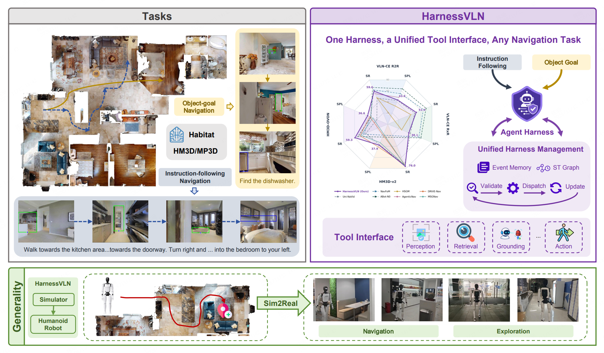

<div align="center">

# 🧭 HarnessVLN

**HarnessVLN: Unifying Training-Free Embodied Navigation through an Agent Harness**

[](https://arxiv.org/pdf/2609.15195)
[](https://agibot-harnessvln.netlify.app/)

[Installation](#setup) · [Quick Start](#quick-start) · [Results](#results) · [Citation](#citation)

</div>

<p align="center">
  
</p>

Code for evaluating HarnessVLN on **VLN-CE R2R (full val_unseen or the rand100
subset), VLN-CE RxR, HM3D-v2 ObjectNav, HM3D-OVON and LangMap**.

<a id="setup"></a>

## 📦 Installation

   

Requires Linux, an NVIDIA GPU and a multimodal chat-completions endpoint.
Run all commands from the repository root.

<details>
<summary><strong>Environment and dependencies</strong></summary>

```bash
conda create -n harnessvln python=3.9
conda activate harnessvln

pip install torch==2.8.0+cu128 torchvision==0.23.0+cu128 torchaudio==2.8.0+cu128 \
  --index-url https://download.pytorch.org/whl/cu128
conda install -y habitat-sim=0.3.1 withbullet -c conda-forge -c aihabitat
pip install -r requirements.txt
```

```bash
mkdir -p third_party
git clone https://github.com/facebookresearch/habitat-lab.git third_party/habitat-lab
git -C third_party/habitat-lab checkout d6ed1c0a0e786f16f261de2beafe347f4186d0d8
git -C third_party/habitat-lab apply "$PWD/patches/habitat-lab-compat.patch"
pip install -e third_party/habitat-lab --no-deps

git clone https://github.com/IDEA-Research/GroundingDINO.git GroundingDINO
git -C GroundingDINO checkout 57535c5a79791cb76e36fdb64975271354f10251
git -C GroundingDINO apply "$PWD/patches/groundingdino-compat.patch"
pip install -e GroundingDINO --no-build-isolation --no-deps

pip install --no-deps \
  'git+https://github.com/facebookresearch/segment-anything.git@dca509fe793f601edb92606367a655c15ac00fdf'
pip install -r navdp/requirements.txt
```

GroundingDINO's CUDA extension requires a matching toolkit and `nvcc`. Set
`CUDA_HOME` and `TORCH_CUDA_ARCH_LIST` for your installation when needed.
Apply the [compatibility patches](patches/README.md) once to clean upstream checkouts.

</details>

Download datasets and pretrained weights from the [upstream projects](THIRD_PARTY.md).
Place task episodes in `data/datasets/episodes/`, scenes in `data/scene_datasets/`,
perception assets in `data/grounded_sam/`, and NavDP weights at
`navdp/navdp-cross-modal.ckpt`. Exact filenames are specified in the
[task configurations](habitat_extensions/config/) and
[evaluation configurations](vlnce_baselines/config/).

| Benchmark | Name | Episode file in `data/datasets/episodes/` | Scenes |
| --- | --- | --- | --- |
| VLN-CE R2R val_unseen | `R2R` | `vlnce_r2r.json.gz`, `vlnce_r2r_gt.json.gz` | MP3D |
| VLN-CE R2R rand100 | `R2R_RAND100` | `vlnce_r2r_rand100.json.gz` | MP3D |
| VLN-CE RxR val_unseen | `RXR` | `vlnce_rxr.json.gz`, `vlnce_rxr_gt.json.gz` | MP3D |
| HM3D-v2 ObjectNav val | `HM3D_V2` | `hm3d_v2.json.gz` | HM3D v0.2 |
| HM3D-OVON val | `HM3D_OVON` | `hm3d_ovon.json.gz` | HM3D v0.2 |
| LangMap single-goal val | `LANGMAP` | `langmap.json.gz`, `langmap_id_map.json` | HM3D v0.2 |

Matterport3D scenes are distributed only under the Matterport Terms of Use:
request access on the [Matterport3D page](https://niessner.github.io/Matterport/)
(sign the agreement and send it to matterport3d@googlegroups.com), then use the
official `download_mp.py` you receive with `--task_data habitat` and extract the
result to `data/scene_datasets/mp3d/`. HM3D v0.2 scenes are requested from
[HM3D](https://aihabitat.org/datasets/hm3d/); the val split goes in
`data/scene_datasets/hm3d/hm3d_v0.2/val/`.

Two episode files are generated locally:

```bash
# R2R rand100: 100 val_unseen episodes with Open-Nav's start headings, from
# https://github.com/YanyuanQiao/Open-Nav
python tools/build_r2r_rand100.py --source /path/to/OpenNav_R2R-CE_100_bertidx.json

# LangMap: annotations from https://huggingface.co/datasets/bo-miao/LangMap in
# data/datasets/langmap/annotations/, plus a clone of the LangMap code for its
# episode blacklist
python tools/build_langmap.py --langmap-repo /path/to/LangMap
```

<a id="quick-start"></a>

## 🚀 Quick Start

Copy the configuration template and fill in your model settings:

```bash
cp .env.example .env
```

```dotenv
MODEL_API_KEY=your-api-key
MODEL_BASE_URL=https://your-endpoint.example/v1
MODEL_NAME=your-multimodal-model
```

Run the included three-episode R2R selection:

```bash
EPISODES=data/datasets/stratified_samples/smoke_3.json GPUS=0 NPROC=1 \
  TIMESTAMP=smoke bash eval_scripts/evaluate.sh R2R
```

Datasets and scenes must be installed before running. For a larger evaluation:

```bash
EPISODES=full GPUS=0 NPROC=1 TIMESTAMP=r2r-eval \
  bash eval_scripts/evaluate.sh R2R
```

Replace `R2R` with `R2R_RAND100`, `RXR`, `HM3D_V2`, `HM3D_OVON` or `LANGMAP` to
select another benchmark; the per-dataset scripts (`eval_scripts/vlnce_r2r.sh`,
`vlnce_rxr.sh`, `hm3d_v2.sh`, `hm3d_ovon.sh`, `langmap.sh`) are equivalent
shortcuts, and `SUBSET=rand100 bash eval_scripts/vlnce_r2r.sh` selects rand100.
Set `GPUS` and `NPROC` for your hardware; use `EPISODES=sample` for the
stratified subset in `data/datasets/stratified_samples/<benchmark>.json`,
`RESUME_FROM=<previous run>` to skip finished episodes, or `DRY_RUN=1` to preview
the command. See [eval_common.sh](eval_scripts/lib/eval_common.sh) for all options.

Evidence-based stop validation (the geometric STOP gate and budget autostop) is
**off by default**; the model's double-checked STOP executes as requested. To
enable it, append the overrides:

```bash
bash eval_scripts/evaluate.sh R2R EVAL.STOP_GEOMETRIC_GATE True \
  EVAL.STOP_AUTOSTOP_BEFORE_TIMEOUT True EVAL.STOP_REJECTION_PANORAMA_COOLDOWN_STEPS 24
```

<a id="results"></a>

## 📊 Results

Outputs are saved to `eval_data/<TIMESTAMP>/`. Compare runs or start the viewer:

```bash
python tools/report_rounds.py run_a run_b --out report.md
python tools/report_vln_ne.py --r2r r2r-eval --rxr rxr-eval   # NE / OSR / NDTW / SR / SPL
python tools/report_langmap.py langmap-eval                   # LangMap SR / SPL per level
python server.py
```

`report_langmap.py` scores success as ending within 0.25 m of a goal viewpoint,
as in the official LangMap evaluation, and also writes the per-episode files that
LangMap's `analyze_langmap_results.py` reads.

After the smoke run, open
[the trajectory viewer](http://localhost:9999/?root=eval_data/smoke/rgb).

## ✅ Checks

```bash
python tools/check_release.py
```

<a id="citation"></a>

## 📝 Citation

If you find HarnessVLN useful, please cite:

```bibtex
@misc{chen2026harnessvlnunifyingtrainingfreeembodied,
  title={HarnessVLN: Unifying Training-Free Embodied Navigation through an Agent Harness},
  author={Yang Chen and Lirong Che and Zhenyu Huang and Wenbo Fu and Chuang Wang and Xu Cao and Daqi Liu and Yuzhe Yang and Jian Su and Lan-Zhe Guo},
  year={2026},
  eprint={2609.15195},
  archivePrefix={arXiv},
  primaryClass={cs.RO},
  url={https://arxiv.org/abs/2609.15195}
}
```

## 📄 License & Acknowledgments

Built on the **LaViRA / Uni-LaViRA** navigation baseline.
See [LICENSE](LICENSE) and [THIRD_PARTY.md](THIRD_PARTY.md) for licensing and
upstream attribution.
